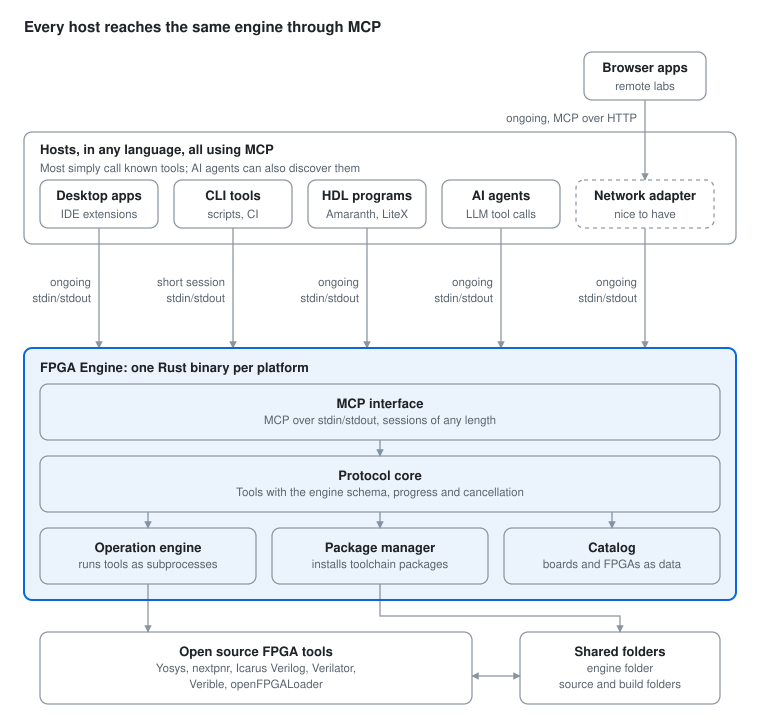

# Architecture

The AI-proposed design for the engine. It follows the [requirements](requirements.md) and is one candidate design, open to change. [Tool API](tool-api.md) details its first operations.

The engine is a single native executable, written in Rust, that exposes its operations as MCP tools over stdin/stdout. Every host launches it as a child process, either for a long session or for a single call. The FPGA work itself is done by proven open source tools that the engine installs and drives.



**Figure 1.** Proposed architecture

Local frontends connect to the engine directly. Remote frontends go through the optional network adapter layer.

## Host connections

All hosts launch the engine as a child process and use MCP over stdin/stdout. [Table 3 in the requirements](requirements.md#frontend-deployment-forms) lists the frontend deployment forms these hosts serve. They differ in session length and in how they use MCP. Session length is chosen by each host and does not affect the engine design.

**Table 1.** Host connections

| Host | Examples | Session | MCP usage |
| --- | --- | --- | --- |
| Desktop apps and IDE extensions | IceStudio, Logix, Apio VS Code | Ongoing | Calls known tools by name |
| CLI tools, scripts and CI | Apio, shell scripts, GitHub Actions | One call per command | Calls one known tool by name |
| HDL programs | Amaranth, LiteX | Ongoing | Calls known tools by name |
| AI agents | MCP-based agents | Ongoing | Discovers tools and their descriptions, then decides what to call |
| Network adapter (nice to have) | Serves browser apps and remote labs | Ongoing | Relays tool calls from remote frontends over MCP over HTTP, with auth and file transfer |

> **Note:** All hosts use the same MCP interface and engine schema. A one-shot call is just a short session with a single tool call, so the engine has no separate command-line mode.

## Components

**Table 2.** Engine components

| Component | Role |
| --- | --- |
| MCP interface | Accepts MCP sessions over stdin/stdout and exposes each operation as a tool |
| Protocol core | Defines the input and output schema of every tool, plus progress and cancellation. The schema is generated from the code |
| Operation engine | Runs operations such as build, simulate and program board as isolated subprocesses, using the inputs and folders given in each request |
| Package manager | Installs, updates and verifies toolchain packages in the engine folder |
| Catalog | Board and FPGA definitions kept as versioned data files, not code |

## Technology selection

**Table 3.** Proposed technologies

| Area | Choice | Reason |
| --- | --- | --- |
| Implementation language | Rust | Chosen mainly for its WebAssembly support, so the engine can also run fully in the browser. It also gives one static binary per platform with no runtime to install, and a strict compiler that catches many AI mistakes |
| Host interface | MCP over stdin/stdout | One standard interface for all hosts, with tool discovery for AI agents and client libraries in many languages. Pinned to MCP 2026-07-28, whose stateless core matches the engine's stateless requests. Clients on MCP 2025-11-25 are also accepted as needed. MCP roots, deprecated in 2026-07-28, are not used |
| MCP library | Official Rust MCP SDK (rmcp) | Implements the MCP protocol, so the engine only defines its tools. Version 3.8 (October 2026) supports MCP 2026-07-28, older clients down to 2025-11-25, and the Tasks extension |
| Async runtime | Tokio | Runs an operation alongside its progress reporting and cancellation |
| Synthesis | Yosys | Standard open source synthesis tool |
| Place and route | nextpnr | Supports the main open FPGA families with IceStorm, Project Trellis and Apicula |
| Simulation | Icarus Verilog, Verilator | Event-driven and fast compiled simulation |
| Lint and format | Verilator, Verible | Mature open source checkers and formatter |
| Board programming | openFPGALoader | Supports a wide range of boards and programmers |
| Toolchain packages | Prebuilt per-platform builds, e.g. from OSS CAD Suite | Avoids building tools from source on user machines |
| In-browser toolchain | YoWASP | Yosys and nextpnr compiled to WebAssembly, for browser apps that run fully in the browser |
| Network adapter (nice to have) | MCP over Streamable HTTP with OAuth | The standard MCP transport and authorization for remote frontends |

## Key design decisions

- **Follows the requirements.** MCP for all hosts, a tool API that never breaks, and stateless requests, as the [requirements](requirements.md) require.
- **Process isolation.** Each tool runs as a subprocess with its own working directory and environment. Cancelling an operation stops its process tree.
- **Concurrency.** Each instance serves one session. Several instances can run at once and share an engine folder, using file locks during package installs.
- **Long operations.** Every operation is a plain tool call with progress and cancellation, which is all local hosts need. MCP 2026-07-28 supports both on stdin/stdout: the host requests progress with a progress token and receives progress notifications, and cancels by sending a cancellation notification with the request ID. The MCP Tasks extension is added later for AI agents, whose tool calls may time out, and for the network adapter, where connections can drop. Inside the engine, both use the same operation model.

## Engine testing

How the project tests the engine itself. Testing user designs is an engine feature, covered under [User design testing](requirements.md#user-design-testing) in the requirements.

- **Schema tests:** every tool's inputs and outputs are checked against the published schema.
- **Golden tests:** the engine's own test designs, Verilog sources with a board ID kept with the engine's tests, are built for each FPGA family and their outputs compared with known-good results. Apio's current Verilog examples are a good starting set.
- **Platform matrix:** CI runs the full suite on every supported platform and architecture.
- **Hardware-in-the-loop tests:** check the engine's own board programming and on-board support on real boards. A lab computer on a supported platform runs them nightly, through a hardware test interface that can drive and observe the boards. The interface is still open.

## Distribution

Per-platform binaries are published on GitHub Releases. PyPI and npm packages make the binary easy to install from Python and JavaScript projects, and a separate npm package holds the WebAssembly build. Each host bundles the engine version it needs.

## Appendix: Code examples

These examples are illustrative. They follow the [Tool API](tool-api.md), and the engine binary name and launch options are placeholders.

### Example 1: Apio calling the engine's build operation (Python)

Apio launches the engine, calls the build tool with explicit folders and a board ID, shows progress, and reads the structured result or error. It uses the official MCP Python SDK.

```python
import asyncio
import os
from mcp import ClientSession, StdioServerParameters
from mcp.client.stdio import stdio_client

# Launch the engine as a child process, passing its engine folder.
ENGINE = StdioServerParameters(
    command="fpga-engine",                      # engine binary bundled with Apio
    args=["--engine-folder", os.path.expanduser("~/.apio/engine")],
)

async def on_progress(progress, total, message):
    print(f"[{progress}/{total or '?'}] {message or ''}")

async def build():
    async with stdio_client(ENGINE) as (read, write):
        async with ClientSession(read, write) as session:
            await session.initialize()          # not needed with MCP 2026-07-28

            result = await session.call_tool(
                "build",
                {
                    "board": "icestick",                    # catalog ID, or a full definition
                    "top_module": "main",
                    "source_folder": "/home/u/proj",
                    "source_files": ["main.v"],
                    "constraint_file": "pinout.pcf",
                    "build_folder": "/home/u/proj/_build/default",
                },
                progress_callback=on_progress,
            )

            data = result.structuredContent
            if result.isError:
                # Error model: category, message, diagnostics, suggested action.
                print(f"{data['category']}: {data['message']}")
                for d in data.get("diagnostics", []):
                    print(f"  {d['file']}:{d['line']}: {d['text']}")
                return 1

            print("Bitstream:", data["bitstream"])
            for name, r in data["resources_usage"].items():
                print(f"{name}: {r['used']}/{r['available']}")
            return 0

asyncio.run(build())
```

Apio needs no knowledge of the underlying tools. All folders are explicit in the request, as the stateless rule requires, and errors arrive as data that Apio formats for its own CLI.

### Example 2: IceStudio calling the build operation (JavaScript)

IceStudio's designs are block diagrams, so it first turns the diagram into Verilog and a constraint file, writes them to a source folder, and then calls the engine. Design errors come back with file and line, which IceStudio maps back to the blocks that produced them. It uses the official MCP TypeScript SDK.

```javascript
const fs = require("fs");
const path = require("path");
const { Client } = require("@modelcontextprotocol/sdk/client/index.js");
const { StdioClientTransport } = require("@modelcontextprotocol/sdk/client/stdio.js");

// IceStudio's own pieces, not part of the engine:
//   compiler.generate(design) turns the block diagram into Verilog and a
//   constraint file, plus a source map from Verilog lines back to blocks.
//   ui.* shows progress, errors and highlights in the IceStudio window.
const compiler = require("./compiler");
const ui = require("./ui");

async function build(design, workDir) {
  // 1. Turn the block diagram into files the engine can read.
  const sourceFolder = path.join(workDir, "src");
  const buildFolder = path.join(workDir, "build");
  fs.mkdirSync(sourceFolder, { recursive: true });
  const { verilog, pcf, sourceMap } = compiler.generate(design);
  fs.writeFileSync(path.join(sourceFolder, "main.v"), verilog);
  fs.writeFileSync(path.join(sourceFolder, "main.pcf"), pcf);

  // 2. Launch the engine bundled with IceStudio.
  const transport = new StdioClientTransport({
    command: "fpga-engine",
    args: ["--engine-folder", path.join(ui.homeDir(), ".icestudio", "engine")],
  });
  const client = new Client({ name: "icestudio", version: "1.0.0" });
  await client.connect(transport);

  try {
    // 3. Build, with progress in IceStudio's status bar.
    const result = await client.callTool(
      {
        name: "build",
        arguments: {
          board: design.board,                  // catalog ID, or a full definition
          top_module: "main",
          source_folder: sourceFolder,
          source_files: ["main.v"],
          constraint_file: "main.pcf",
          build_folder: buildFolder,
        },
      },
      undefined,
      { onprogress: (p) => ui.showProgress(p.progress, p.total, p.message) },
    );

    // 4. Show the result on the diagram.
    const data = result.structuredContent;
    if (result.isError) {
      for (const d of data.diagnostics ?? []) {
        const block = sourceMap.blockAt(d.line);   // Verilog line -> block
        ui.highlightBlock(block, d.text);
      }
      ui.showError(`${data.category}: ${data.message}`);
      return;
    }
    ui.showResources(data.resources_usage);             // e.g. LUTs used and available
    ui.showSuccess("Build done");
  } finally {
    await client.close();
  }
}

module.exports = { build };
```

The engine never sees the block diagram. IceStudio owns the design format and the mapping back to blocks, while the engine does the build from plain files in shared folders.

### Example 3: Apio VS Code extension calling the build operation (JavaScript)

The extension runs a build with a cancellable VS Code progress notification, and shows design errors in the Problems panel. It uses the official MCP TypeScript SDK, which also works from JavaScript.

```javascript
const vscode = require("vscode");
const os = require("os");
const path = require("path");
const { Client } = require("@modelcontextprotocol/sdk/client/index.js");
const { StdioClientTransport } = require("@modelcontextprotocol/sdk/client/stdio.js");

const diagnostics = vscode.languages.createDiagnosticCollection("apio");

async function build(projectDir) {
  // Launch the engine as a child process, passing its engine folder.
  const transport = new StdioClientTransport({
    command: "fpga-engine",                       // engine binary bundled with Apio
    args: ["--engine-folder", path.join(os.homedir(), ".apio", "engine")],
  });
  const client = new Client({ name: "apio-vscode", version: "1.0.0" });
  await client.connect(transport);

  try {
    await vscode.window.withProgress(
      { location: vscode.ProgressLocation.Notification, title: "Apio build", cancellable: true },
      async (progress, token) => {
        // Cancelling in VS Code cancels the engine operation.
        const abort = new AbortController();
        token.onCancellationRequested(() => abort.abort());

        const result = await client.callTool(
          {
            name: "build",
            arguments: {
              board: "icestick",                    // catalog ID, or a full definition
              top_module: "main",
              source_folder: projectDir,
              source_files: ["main.v"],
              constraint_file: "pinout.pcf",
              build_folder: `${projectDir}/_build/default`,
            },
          },
          undefined,
          {
            signal: abort.signal,
            onprogress: (p) => progress.report({ message: p.message }),
          },
        );

        const data = result.structuredContent;
        diagnostics.clear();
        if (result.isError) {
          // Show design errors in the Problems panel, at their file and line.
          for (const d of data.diagnostics ?? []) {
            const uri = vscode.Uri.file(`${projectDir}/${d.file}`);
            const line = Math.max(d.line - 1, 0);
            const range = new vscode.Range(line, 0, line, 0);
            diagnostics.set(uri, [
              ...(diagnostics.get(uri) ?? []),
              new vscode.Diagnostic(range, d.text, vscode.DiagnosticSeverity.Error),
            ]);
          }
          vscode.window.showErrorMessage(`${data.category}: ${data.message}`);
          return;
        }

        const usage = Object.entries(data.resources_usage)
          .map(([name, r]) => `${name} ${r.used}/${r.available}`)
          .join(", ");
        vscode.window.showInformationMessage(`Build done. ${usage}`);
      },
    );
  } finally {
    await client.close();                            // closes the session; the engine exits
  }
}

module.exports = { build };
```

The extension maps engine results onto VS Code's own features: progress and cancellation onto a progress notification, and diagnostics onto the Problems panel. It never parses tool output.
