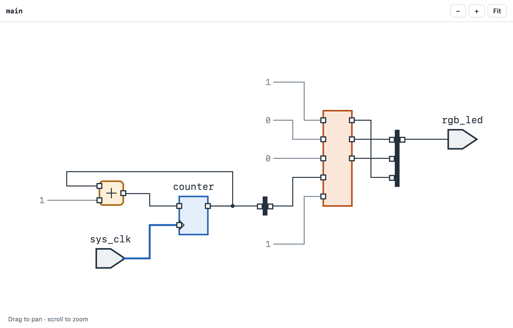
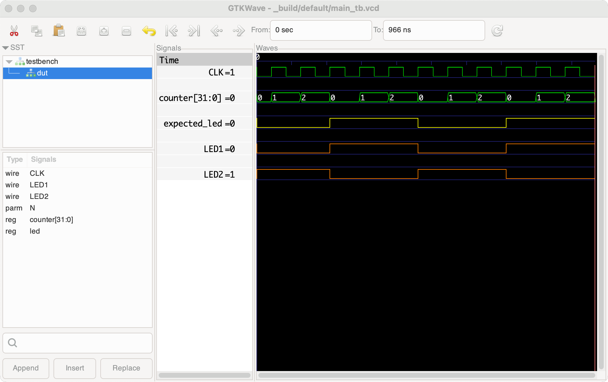

# FPGA Design with Logix Engine and Claude Code

In this tutorial, [Claude Code](https://claude.com/claude-code) designs
hardware for you through Logix Engine. You describe what you want, such as
"make the LED fade through the colors of the rainbow", and Claude writes the necessary source
files, builds them, tests them, shows the waveforms and programs the board.
You don't need to set up a toolchain, write Verilog yourself or even
understand the Verilog language.

> [!TIP]
> The prompts in this tutorial are in English, but you can write them in any
> language Claude understands, such as Spanish, German, Hebrew or Japanese.

## Background

Logix Engine ("the engine" in short) is an open source MCP server that takes
care of the FPGA design cycle: lint, build, test, simulate and program the
board. It works with AI agents such as Claude Code, and with regular apps
such as the [Logix IDE](https://www.openlogix.org/ide/). It downloads the
open source FPGA tools it needs, and knows about boards, with their FPGAs and
pins. Logix Engine is part of the [Open Logix](https://www.openlogix.org)
project.

## What you need

- **A computer:** a Mac with Apple Silicon (M1 or later), or a 64-bit (x64) PC
  with Windows 10 or 11, or with Linux (such as Ubuntu 22.04 or later).
- **Claude Code:** installed and signed in to your Claude account, so that
  `claude` starts it in a terminal (on Windows, in PowerShell). If it isn't installed yet, follow the
  official [Claude Code installation instructions](https://code.claude.com/docs/en/setup).
- **An FPGA board:** one of the engine's [supported boards](https://www.openlogix.org/logix-catalog/boards/), and its USB cable. The
  examples use the **iCESugar v1.5**, which has an RGB LED and 4 switches.
  Any supported board works: replace "iCESugar v1.5" with your board in the
  prompts, and Claude adapts the designs to it. You can also add a board
  that isn't on the list ([custom boards](tool-api.md#board-specification)),
  but that's outside this tutorial.

> [!NOTE]
> Without a board, you can still do every step but 9.

Each text block is labeled with where it goes:

**Terminal:**

```sh
echo "a command"
```

**Claude Code:**

```text
A prompt.
```

Type the prompts as they are, or in your own words or language.

Where the steps differ between macOS, Windows and Linux, they have a tab for
each: choose yours once, and every tab follows. On Windows, the terminal is
**PowerShell** (Start menu, type `PowerShell`).

## 1. Start Claude Code in a new folder

Make a folder for the tutorial's project, and start Claude Code there:

=== "macOS"

    **Terminal:**

    ```sh
    mkdir -p ~/logix-tutorial
    cd ~/logix-tutorial
    claude
    ```

=== "Windows"

    **PowerShell:**

    ```powershell
    mkdir $HOME\logix-tutorial
    cd $HOME\logix-tutorial
    claude
    ```

=== "Linux"

    **Terminal:**

    ```sh
    mkdir -p ~/logix-tutorial
    cd ~/logix-tutorial
    claude
    ```

If Claude Code asks whether you trust the folder, say yes.

## 2. Let Claude install the engine

Claude installs Logix Engine for you, following this page:

**Claude Code:**

```text
Install Logix Engine for me. Follow "Install the engine yourself" at
https://www.openlogix.org/logix-engine/tutorial-claude-code/
```

Claude downloads the engine from its Latest release, checks that it runs,
and connects it to Claude Code. It asks before each command it runs: read
what it says, and approve. It ends by asking you to restart Claude Code.

Restart Claude Code: type `/exit`, then start it again in the same folder:

**Terminal:**

```sh
claude
```

Check that it's connected:

**Claude Code:**

```text
/mcp
```

The list shows `logix-engine` as connected. If you'd rather install the
engine yourself, or Claude gets stuck, follow
[Install the engine yourself](#install-the-engine-yourself) at the end of
this page, then come back here.

## 3. Meet the engine

Ask what the engine can do:

**Claude Code:**

```text
What can Logix Engine do? Keep it short.
```

Claude lists the engine's tools: lint, build, test, simulate, program the
board and more.

> [!IMPORTANT]
> The first time Claude uses one of the engine's tools, Claude Code asks for
> permission: choose **"Yes, and don't ask again"** for the `logix-engine`
> tools, so the rest of the tutorial flows. Claude also asks before it
> writes files in your folder.

Now tell the engine to fetch the open source FPGA tools it needs:

**Claude Code:**

```text
Download the FPGA tools the engine needs, and show me the progress.
```

> [!NOTE]
> The tools are downloaded into the engine's own folder,
> `.logix/claude-code/engine` in your home folder, and don't change your
> computer's setup. This takes
> a minute or two, only the first time.

## 4. Choose your board

**Claude Code:**

```text
Which boards does the engine support? Group them by FPGA family, names only.
```

The engine knows about 80 boards: their FPGA, how to program them, and
what's on their pins. Find yours, and ask about it:

**Claude Code:**

```text
Tell me about the iCESugar v1.5: its FPGA, its clock, its LED and its switches.
```

Claude answers from what the engine knows about its [supported boards](https://www.openlogix.org/logix-catalog/boards/): an iCE40 UltraPlus UP5K, a
12 MHz clock on pin 35, an RGB LED that's lit when its pins are low, and 4
switches, with their pins. It never has to guess a pin.
To see how two boards differ:

**Claude Code:**

```text
Compare the iCESugar v1.5 with the iCEBreaker.
```

## 5. Blink an LED

**Claude Code:**

```text
Start a new project here for the iCESugar v1.5: blink the RGB LED in green about once a second. Then build it.
```

Claude writes three files and builds them:

- `main.v`: the design, a counter whose top bit drives the LED's green pin.
- `pinout.pcf`: which FPGA pins the design's signals use.
- `logix.json`: Claude's notes on the project, such as its board.

The build ends with a bitstream in the `_build/` folder in the project, and
a short report: how much of the FPGA the design uses, and the fastest clock
it could run at.

## 6. See it as a diagram

**Claude Code:**

```text
Make a diagram of the design and open it.
```

The engine draws the design as a schematic and opens it in your web browser:
the counter's register, the adder that counts, and the pins.



Try it:

- **Hover** over a block or a wire to see its details, such as a signal's
  name and width.
- **Drag** to move the drawing, **scroll** to zoom, and click **Fit** to see
  all of it again.
- Ask Claude about what you see, such as "What's the block between the
  counter and the LED?"

## 7. Test it

On an FPGA, you test before you program the board. Ask for a testbench, a
simulation that checks what the design does:

**Claude Code:**

```text
Write a testbench that checks the green LED turns on and off at the right times, using a small counter so the test is quick. Run it.
```

Claude writes `main_tb.v`, and the test passes. Now see a failure:

**Claude Code:**

```text
Change the testbench to expect the LED to turn on one clock cycle too early. Run it, explain the failure, then put it back.
```

The engine reports the failed check at its line and simulation time, and
Claude explains what went wrong.

## 8. See the signals

**Claude Code:**

```text
Simulate the testbench and open the waveforms in GTKWave.
```

GTKWave, a waveform viewer, opens with the clock, the counter and the LED.



Try it:

- **Read the waves:** each row on the right is one signal over time, from
  left to right: the clock ticking, the counter counting up, and the LED
  turning on and off as the counter's top bit changes.
- **Zoom** with the zoom buttons in GTKWave's toolbar, to see single clock
  cycles or the whole simulation.
- **Add a signal:** select the testbench in the tree at the top left, select a
  signal in the list below it, and click **Append**.

Close GTKWave when you're done.

## 9. Program the board

Connect the board with its USB cable.

**Claude Code:**

```text
Is my board connected?
```

Claude lists what's connected, and how well each device matches your board.

=== "macOS"

    No driver is needed: macOS lets the engine program every board as it is.

=== "Windows"

    The iCESugar v1.5 needs no driver. Many other boards, such as those with
    an FTDI chip, need the WinUSB driver before the engine can program them,
    and Claude says so when it lists the devices. Then ask:

    **Claude Code:**

    ```text
    Install the driver my board needs.
    ```

    Claude explains what changes and asks you first. Then Windows asks
    whether Logix Engine may make changes to your device: choose **Yes**.
    Installing takes a minute or two. To give the board its old driver back
    later, for the board maker's own tools, ask Claude to remove it.

=== "Linux"

    On Linux, your board needs a udev rule that lets your user account open
    it before the engine can program it. If Claude says it
    can't open the board, ask:

    **Claude Code:**

    ```text
    Write the udev rule my board needs, and tell me how to install it.
    ```

    Claude writes a rule for your board's USB IDs only, and gives you the
    commands that install it, which ask for your password (`sudo`). Then
    unplug the board and plug it in again.

Then:

**Claude Code:**

```text
Program the board with the design.
```

The LED blinks green, about once a second: a design that went from a
sentence to real hardware.

## 10. Change it with prompts

From here on, say what you want, and Claude changes the design in your
project folder, tests it and programs the board. Try these one at a time,
and watch the board after each:

**Claude Code:**

```text
Change the design: make the LED step through its 8 colors (off, red, green, blue and their mixes), about 2 a second. Update the testbench, run it, then program the board.
```

**Claude Code:**

```text
Use the 4 switches: switch 1 pauses the colors, and switches 2 to 4 set the speed. Test it and program the board.
```

**Claude Code:**

```text
Make the LED fade smoothly through the colors of the rainbow, using PWM. Program the board.
```

**Claude Code:**

```text
When switch 1 is on, make the LED breathe slowly on and off in blue, like a sleeping laptop, instead of the rainbow.
```

Bigger changes work too:

**Claude Code:**

```text
Put the rainbow in its own module with a speed parameter, give it its own testbench, and keep main.v short. Run all the tests.
```

> [!TIP]
> If the board does something you didn't expect, say what you see, such as
> "the LED is green when it should be red", and let Claude find out why.

## 11. Ask questions

Claude knows your design and the engine's reports, so ask about either:

**Claude Code:**

```text
How much of the FPGA does the design use now? What uses the most?
```

**Claude Code:**

```text
What's the fastest clock this design could run at, and what limits it?
```

**Claude Code:**

```text
Explain main.v line by line, as if I'm new to Verilog.
```

**Claude Code:**

```text
Why did you choose that counter width? What would happen with a 20-bit counter?
```

## 12. When things go wrong

The engine reports problems as data, with their file and line, so Claude can
fix them:

**Claude Code:**

```text
Put a typo in main.v on purpose, build it, show me the error, then fix it.
```

**Claude Code:**

```text
Check the design for warnings with the linter, and fix them.
```

**Claude Code:**

```text
Format all the Verilog files.
```

Disconnect the board, then:

**Claude Code:**

```text
Program the board with the design.
```

Claude reports that the board isn't connected, and what to check. Connect it
again and ask again.

## 13. Keep going

Some ideas, each one prompt:

- "Send 'hello' over the board's USB serial port once a second, and show me how to read it on my computer."
- "Make a reaction game: light the LED in a random color, and count how long until I flip switch 1."
- "Turn the color sequence into a table at the top of main.v that I can edit."
- "Make the design work on the iCEBreaker too." Then ask what changed.

Start each new design in its own folder, and run `claude` there.

## Clean up

- Build files: ask Claude to clean the build folder, or delete `_build/`.
- To disconnect the engine from Claude Code:
  `claude mcp remove --scope user logix-engine`
- To remove the engine, delete the `logix-engine` folder in your
  **Downloads** folder, and its engine folder, `.logix/claude-code/engine` in
  your home folder. On Windows, if Claude installed a WinUSB driver for a
  board, ask Claude to remove it first. On Linux, if you installed a udev
  rule for a board, delete its file in `/etc/udev/rules.d/` (with `sudo`).

## Install the engine yourself

These are the steps Claude follows in step 2, if you'd rather do them
yourself. Claude: run them for the user, on their computer, then ask them to
restart Claude Code.

1. **Install the engine.** Open the engine's
    [**Latest** release](https://github.com/openlogix/logix-engine/releases/latest)
    and follow the steps for your system on that page, up to checking that the
    engine runs. They say exactly what that release needs, such as a step for
    files that aren't signed yet. Newer pre-releases on the
    [releases page](https://github.com/openlogix/logix-engine/releases) are
    development builds.

    The check prints the engine's version, a date such as `2026.11.09`. The
    steps unpack the engine into a `logix-engine` folder in your **Downloads**
    folder, which the next step uses.

2. **Connect Claude Code to the engine.** Register the engine with Claude
    Code once, for every folder:

    === "macOS"

        **Terminal:**

        ```sh
        ENGINE=~/Downloads/logix-engine/logix-engine
        ENGINE_HOME=~/.logix/claude-code/engine
        claude mcp add -s user logix-engine -- $ENGINE --engine-folder $ENGINE_HOME
        claude mcp list
        ```

    === "Windows"

        **PowerShell:**

        ```powershell
        $ENGINE = "$HOME\Downloads\logix-engine\logix-engine.exe"
        $ENGINE_HOME = "$HOME\.logix\claude-code\engine"
        claude mcp add -s user logix-engine '--' $ENGINE --engine-folder $ENGINE_HOME
        claude mcp list
        ```

        The quotes around `--` keep PowerShell from dropping it.

    === "Linux"

        **Terminal:**

        ```sh
        ENGINE=~/Downloads/logix-engine/logix-engine
        ENGINE_HOME=~/.logix/claude-code/engine
        claude mcp add -s user logix-engine -- $ENGINE --engine-folder $ENGINE_HOME
        claude mcp list
        ```

    The list shows `logix-engine` as connected. The engine keeps the FPGA tools
    it downloads, and its logs, in its engine folder, `.logix/claude-code/engine`
    in your home folder. Each Claude Code session's logs are in a folder of
    their own in its `logs` folder, named by the session's start time.

3. **Restart Claude Code**, so it connects to the engine: `/exit`, then
    `claude` in the project folder.

## Learn more

- [Logix Engine](https://www.openlogix.org/engine/): what it is and where
  it's going.
- [Tool API](tool-api.md): every tool Claude used here, for writing your own
  frontend or agent.
- [Logix IDE](https://www.openlogix.org/ide/): the same engine in an app,
  the Arduino experience, for FPGAs.
- [Supported boards](https://www.openlogix.org/logix-catalog/boards/) and [supported FPGAs](https://www.openlogix.org/logix-catalog/fpgas/): what the engine
  works with, and how to add your own board.

Logix Engine is free and open source, under MIT or Apache 2.0. To report a
problem or share an idea, open an issue on
[GitHub](https://github.com/openlogix/logix-engine/issues).
